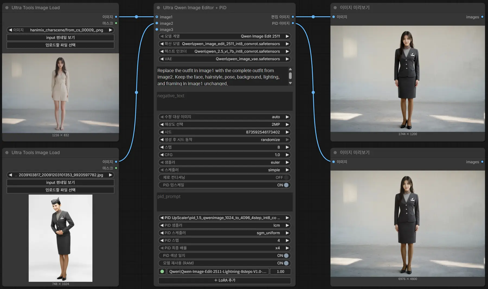

# Ultra Qwen Image Editor + PiD — v1.0.7

**Qwen 2511·2.1 + MiniMax H3 Image 통합 편집 / Multi-family native ComfyUI image editor**

[](LICENSE)

이미지를 입력하고 자연어로 편집합니다. **Qwen Image Edit 2511**, **Qwen Image 2.1(Base/Turbo)**, **MiniMax H3 Image**를 지원하며, 모델별 입력 한도는 각각 **3·10·16장**입니다. LoRA를 적용할 수 있고, **PiD 업스케일은 Qwen 2511에 한해 선택적으로 제공**합니다.

**English overview:** Ultra Qwen Image Editor + PiD is a native ComfyUI custom node for reference-guided image editing with **Qwen Image Edit 2511**, **Qwen Image 2.1 (Base/Turbo)**, and **MiniMax H3 Image**. Connect reference images, select the edit target, and describe changes in Korean or English. MiniMax H3 recommends **Euler/simple/6** for its checkpoint PDD grid while allowing experimental sampler/scheduler/step adjustments; other model families retain their existing sampling paths.

It accepts up to **3 inputs for Qwen 2511, 10 for Qwen 2.1, or 16 for MiniMax H3**, with dynamically added numbered sockets. If too many images remain linked, switching to a lower-cap family is **refused with a warning**: **the user manually disconnects unwanted inputs; no link is deleted automatically**. English/Korean `imageN` references are renumbered for the chosen edit target and, for H3, converted to `<Picture N>`. Qwen 2.1 Turbo's **8-step built-in sigma** behavior remains unchanged. Optional **PiD x2/x4 and color matching are available only for Qwen 2511**. Connect outputs to `Save Image`.


## 실제 편집 예시 / Image editing workflow



*정상 실행 예시: Qwen Image Edit 2511의 두 참조 이미지, 편집 결과, 선택적 PiD 업스케일 결과를 함께 보여줍니다. / A working Qwen Image Edit 2511 workflow showing two reference images, the edited output, and optional PiD upscaling. Widget labels automatically follow the ComfyUI Korean/English language setting.*

## 함께 사용하기 / Recommended companion: Prompt Selector v4.0.0

**한국어:** [야문짱의 Ultra Qwen Image Edit Prompt Selector v4.0.0](https://github.com/Yamoon-jjang/Ultra-Qwen-Image-Edit-Prompt-Selector/releases/tag/v4.0.0)와 함께 사용하면 **프롬프트 작성부터 Qwen 이미지 편집 실행까지 두 앱의 장점을 최대한 활용**할 수 있습니다. 선택기는 브라우저에서 실행되는 별도 HTML 앱으로, **4,927개 편집 프리셋**을 조합해 영어 프롬프트를 작성합니다. 완성된 문장을 이 ComfyUI 노드의 **Positive Prompt(긍정 프롬프트)**에 붙여 넣으면 됩니다. 별도의 프로그램 간 자동 연결이나 플러그인은 필요하지 않습니다.

**English:** Pair this custom node with **[Ultra Qwen Image Edit Prompt Selector v4.0.0](https://github.com/Yamoon-jjang/Ultra-Qwen-Image-Edit-Prompt-Selector/releases/tag/v4.0.0)** for a more streamlined prompt-to-edit workflow. The standalone browser tool combines **4,927 image-editing presets** into a structured English prompt. **Copy** its output into this node's **Positive Prompt** field, then run your Qwen Image Edit 2511 or Qwen Image 2.1 workflow. The two tools complement each other; they are **not automatically connected**.

**권장 사용 순서 / Suggested steps:** 선택기에서 1~3장 이미지와 프리셋 선택 → 영어 프롬프트 복사 → 본 노드에 동일한 순서로 이미지 연결 → `Edit Target = image1` 확인 → **Positive Prompt**에 붙여넣기 → 실행. / Select 1–3 images and presets in the Selector → copy the English prompt → connect corresponding images in order → confirm `Edit Target = image1` → paste into **Positive Prompt** → run.

> **참고 / Note:** 선택기는 **최대 3장**의 `image1`–`image3` 역할을 작성합니다. 이 노드는 모델에 따라 **3(2511)·10(2.1)·16(MiniMax H3)**장까지 입력을 지원합니다. `Edit Target` 변경 시 이미지 번호 참조가 재매핑됩니다. / The Selector describes up to **3** images; this node supports **3/10/16**. References are renumbered when you change the edit target.

## 한글·영문 자동 전환 / Automatic Korean & English UI

**한국어:** ComfyUI의 언어 설정을 한국어 또는 영어로 변경하면, 노드의 **설정 이름·툴팁·LoRA 메뉴·안내 알림**이 자동으로 바뀝니다. 노드를 다시 설치하거나 언어팩을 수동으로 선택할 필요가 없습니다. 프롬프트는 한국어와 영어 모두 입력할 수 있습니다.

**English:** The node automatically follows ComfyUI's **Korean/English language setting**. Widget labels, contextual tooltips, LoRA controls, and user notifications switch to the selected language without a separate language pack or reinstall. Editing prompts may be written in either Korean or English. Technical identifiers such as model filenames, `imageN` sockets, sampler options, and stored workflow values intentionally remain unchanged to protect compatibility.

## Features / 주요 기능

| 기능 / Feature | 설명 / Description |
| --- | --- |
| 모델 / Models | Qwen Image Edit 2511; Qwen Image 2.1 Base/Turbo; MiniMax H3 Image |
| 입력 이미지 / Inputs | 2511: 최대 3장 / 3; 2.1: 최대 10장 / 10; MiniMax H3: 최대 16장 / 16 |
| 수정 대상 / Edit Target | `image1` 또는 연결된 다른 입력 선택 / select a connected image |
| 프롬프트 / Prompts | 노드 내부 긍정·부정 프롬프트 / built-in positive and negative prompts |
| 참조 번호 / References | 한·영 이미지 번호 자동 대응 / Korean & English numbered references |
| 해상도 / Resolution | Qwen: 약 0.5·1·1.5·2MP; MiniMax H3: 4·8·16MP, 원본, 사용자 지정 / Original and Custom also available |
| 샘플링 / Sampling | Qwen 2.1 Turbo: 8-step native sigma; MiniMax H3: **Euler/simple/6 기본 권장**, Steps·Sampler·Scheduler 실험적 조정 가능; CFG 1, RAM reuse OFF |
| LoRA | 다중 LoRA·강도·순서·개별 ON/OFF / multiple LoRAs, strengths, ordering |
| PiD | Qwen 2511 전용 x2/x4 결과 및 선택적 색감 보정; 2.1/H3는 OFF 잠금 |
| 언어 / Language | ComfyUI `Comfy.Locale` 기반 한글·영문 UI / KO-EN UI labels and tooltips |

## 설치 / Installation

**방법 1 — Git 설치 (권장) / Method 1 — Git clone (recommended)**

ComfyUI를 완전히 종료한 뒤, 터미널/PowerShell에서 `ComfyUI/custom_nodes` 폴더로 이동해 다음 명령을 실행합니다. / Close ComfyUI and open a terminal in the `ComfyUI/custom_nodes` directory:

```bash
git clone https://github.com/Yamoon-jjang/comfyui-Ultra-Qwen-Image-Editor.git
```

업데이트 / To update an existing Git installation:

```bash
cd comfyui-Ultra-Qwen-Image-Editor
git pull
```

**방법 2 — ZIP 설치 / Method 2 — ZIP download**

GitHub Releases의 ZIP을 다운로드해 압축을 풀고 `ComfyUI/custom_nodes/comfyui-Ultra-Qwen-Image-Editor/` 구조로 배치합니다. / Download the release ZIP and extract the included folder directly under `ComfyUI/custom_nodes/`.

**중복 설치 금지 / Avoid duplicate installations:** 예전 폴더 `comfyui-Ultra-Image-Editor` 또는 새 폴더의 다른 복사본이 있으면 ComfyUI를 종료한 상태에서 `custom_nodes` 밖으로 옮기세요. / Move any previous `comfyui-Ultra-Image-Editor` directory or duplicate copies out of `custom_nodes` before starting ComfyUI.

**최초 실행 / First run:** Install matching diffusion model, text encoder, and VAE in the normal ComfyUI model directories. Restart ComfyUI and search for `Ultra Qwen Image Editor + PiD`. Connect `image1` and send `Edited Image` to `Save Image`. This node declares no additional pip dependencies.

최근 버전의 ComfyUI 코어와 호환 모델 파일이 필요합니다. 선택적 PiD에는 지원되는 QwenImage PiD 체크포인트와 Gemma 2 ELM 인코더가 별도로 필요합니다. / A recent ComfyUI build with the Qwen edit core nodes is required; optional PiD also needs its compatible checkpoint and Gemma 2 ELM encoder.

## 빠른 사용 / Quick start

1. `Model Family`에서 **Qwen Image Edit 2511**, **Qwen Image 2.1**, **MiniMax H3 Image** 중 선택합니다.
2. 계열에 맞는 `Diffusion Model`, `Text Encoder`, `VAE`를 선택합니다.
3. `image1`에 편집할 이미지를 연결합니다. 이미지가 두 장 이상이면 `Edit Target`을 선택합니다.
4. 긍정 프롬프트에 편집 지시를 작성합니다. `image1`, `image2`, `이미지1`, `이미지2` 등 **입력 단자 번호**를 사용하세요.
5. `Steps`, `CFG`, `Sampler`, `Scheduler`, 해상도 및 선택적 LoRA를 설정합니다.
6. 이미지 출력을 `Save Image`에 연결하여 생성합니다.

*Example / 예시:* `이미지1의 옷을 유지하고 이미지2의 배경으로 변경해줘.` / `Keep the outfit from image1 and use the background from image2.`

**참고 / Note:** `이미지 1과 2` 또는 `image 1 and 2`처럼 번호를 묶어 쓰는 대신 **`이미지1과 이미지2` / `image1 and image2`**처럼 각각 명시하세요. / Name each reference explicitly to ensure correct renumbering.

## 모델별 기본 동작 / Sampling

| 계열 / Family | 일반적인 초기값 / Starting values | 샘플링 / Sampling |
| --- | --- | --- |
| Qwen Image Edit 2511 | 20 Steps, CFG 4 | KSampler |
| Qwen Image 2.1 Base | 25 Steps, CFG 1 | KSampler |
| Qwen Image 2.1 Turbo | 8 Steps, CFG 1 | **Steps=8:** built-in sigma schedule; **other steps:** KSampler |
| MiniMax H3 Image | 6 Steps, CFG 1 권장 | Euler/simple/6은 체크포인트 PDD 경로, 다른 Steps·Sampler·Scheduler는 실험적; CFG 1, PiD OFF, RAM reuse OFF; IMAGE 입력은 1장 |

Turbo의 8스텝 경로에서는 선택한 `Sampler`와 `CFG`가 반영되지만 `Scheduler` 값은 사용되지 않습니다. Turbo에서도 Steps와 CFG를 자유롭게 변경할 수 있습니다. / In Turbo's 8-step mode, CFG and Sampler are active but Scheduler is ignored; other step counts use the chosen KSampler scheduler.

## MiniMax H3 Image — 공식 편집 경로 / Official image-edit path

- 모델 / Diffusion: `minimax_h3_image_pruned_int8_convrot.safetensors` → `models/diffusion_models/`
- 텍스트 인코더 / Text encoder: `qwen3vl_32b_minimax_h3_int8_convrot.safetensors` → `models/text_encoders/`
- VAE: `minimax_h3_image_vae_fp16.safetensors` → `models/vae/`
- 설치 전 최신 ComfyUI의 `MiniMaxH3ImageConditioning`을 사용 가능한지 확인하세요. / Update ComfyUI to a version providing the native MiniMax H3 conditioning node.

**해상도 / Resolution:** 기본 4MP와 8MP는 공식 방식대로 전체 픽셀을 area 보간한 다음 32픽셀 격자에 맞춰 **cover-crop(가장자리 잘라내기)**합니다. 16MP도 같은 방식이지만 원본 비율이 공식 16MP 규격에 3% 이내로 가까우면 정확한 네이티브 크기로 중앙 크롭합니다. `original`은 원본 크기에서 32배수 cover-crop만 합니다. `custom`은 요청한 32배수 캔버스에 패딩해 원본 전체를 보존합니다. 모든 고해상도 크기는 이미지 할당 전에 검증합니다. / Presets use area resize and a 32px cover-crop, except that 16MP snaps to an exact native canvas when within 3% of its aspect ratio. Original only cover-crops; Custom pads to retain the full source. Oversized canvases are rejected before allocation.

**16MP 네이티브 지원 / Native ~16MP:** 공식 4096×4096, 4736×3552, 5024×3360, 5472×3072, 6272×2688 등의 해상도는 PiD 없이 모델이 직접 생성합니다. H3의 가로·세로는 ComfyUI 코어 범위인 최대 16384px로 별도 처리하며, 다른 Qwen 계열은 종전 8192px 제한을 유지합니다. 극단적인 가로세로 비율에서 코어 한도를 넘는 경우에는 실제 리사이즈 전에 경고합니다. H3 `custom`에서 가로·세로가 모두 0이면 약 4MP로 계산합니다. / MiniMax H3 generates native ~16MP (including ComfyUI's listed aspect ratios) without PiD. Only the H3 path uses the native 16384px per-axis bound; legacy Qwen keeps 8192px. Extreme aspect ratios are validated before image allocation. Both Custom dimensions at zero default to ~4MP for H3.

**H3 사전 검사 / H3 preflight:** 확산 모델·텍스트 인코더·VAE의 설치 여부와 H3 계열 호환성을 4–16MP 참조 이미지 리사이즈보다 먼저 검사합니다. 선택 오류로 불필요한 대용량 이미지 할당이 발생하지 않습니다. / Selected H3 asset names and family compatibility are checked before a potentially large reference-image resize.

**모델 자동 추천 / Model suggestions:** MiniMax H3를 처음 선택하는 경우 설치된 `int8_convrot` 확산 모델 및 텍스트 인코더를 우선 추천합니다. 이미 저장한 모델별 설정과 사용자가 직접 선택한 파일은 변경하지 않습니다. 이미지 연결 한도를 초과하면 정확한 초과 단자와 개수(수정 대상 포함 여부)를 알리고 모델 전환을 막습니다. 링크 해제는 항상 사용자가 직접 합니다. / First use prefers installed `int8_convrot` assets. Saved model choices are preserved. An over-limit switch warns about all offending connected sockets; the user must manually disconnect them.

**참조와 샘플링 / References & sampling:** `image1`부터 최대 16장까지 순서대로 연결합니다. 수정 대상은 내부에서 `<Picture 1>`이 되고 나머지가 순서대로 재배열됩니다. **6 Steps / Euler / Simple은 H3 체크포인트 `pdd_sigmas`의 공식 권장 경로**입니다. Steps·Sampler·Scheduler는 변경 가능하며 다른 스텝 수에서는 H3 모델 샘플러가 PDD 격자를 보간합니다(실험적). H3에서만 CFG 1·PiD OFF·RAM 재사용 OFF를 적용하며 사용자 Negative Prompt/Zero Conditioning 설정과 빈 이미지 보조는 적용하지 않습니다. 단, CFG 1에서도 무조건 예측을 요구하는 CFG++ 샘플러를 위해 내부적으로 `ConditioningZeroOut(positive)`를 제공합니다. 다른 모델의 샘플링 경로와 설정 기억은 유지합니다. 실제 참조 IMAGE의 비전 토큰 및 latent를 사용하며 각 IMAGE 입력은 배치 1입니다. / Connect up to 16 references; the edit target becomes `<Picture 1>`. **Euler/simple/6** follows checkpoint `pdd_sigmas`. Alternate user-selected sampling is experimental and native H3 sampling interpolates the PDD grid for other step counts. Only H3 locks CFG 1, PiD OFF and asset reuse OFF. User negative text/Zero Conditioning settings are ignored for H3, but an internal zeroed-positive conditioning is supplied for CFG++ samplers. No synthetic blank picture tokens are used. Other model families are unchanged.

**모델 전환 / Switching models:** 예를 들어 MiniMax에서 `image16`까지 연결하고 2511로 바꾸면 경고가 나타나고 **변경을 취소합니다**. 연결선은 한 개도 자동 삭제하지 않습니다. 사용자가 직접 상한을 넘는 연결을 해제한 뒤 재선택하세요. / Changing from H3 with higher image links to Qwen 2511/2.1 is blocked until **you manually disconnect** the extra links. Nothing is removed automatically.

## 설정 저장 / Profile persistence

모델별 Steps·CFG·샘플러·TE·VAE·LoRA·PiD 등은 **생성 요청이 큐에 성공적으로 등록된 뒤** 확정 프로필로 저장됩니다. 이미지가 최종 생성된 시점과는 다릅니다. 생성 전에 편집한 값은 모델 전환 중 **현재 화면 세션에서만** 임시 보관합니다. 긍정·부정 프롬프트, PiD 장면 프롬프트, 수정 대상, 해상도와 시드는 모델 전환 시 현재 값을 유지합니다. 워크플로를 보존하려면 ComfyUI에서 별도 저장하세요.

Per-model sampling, asset and LoRA settings are committed after **successful queue submission**, not after GPU completion. Unsaved drafts survive model switches only in the current editor session. Prompt texts, edit target, resolution and seed stay with the active task. Save the ComfyUI workflow separately for persistence.

## 실제 프롬프트 기록 / Executed prompt record

번역기·LLM 노드 등을 거쳐 들어온 프롬프트도, 노드가 실제로 모델에 넣은 최종 긍정/부정 문장을 이미지 메타데이터(`ultra_generation_prompts`)에 기록합니다. Ultra Exif Reader v4.12 이상에서 Final CLIP 프롬프트로 표시됩니다.

The node records the final positive/negative prompt it actually encoded in the saved image metadata (`ultra_generation_prompts`), even when the prompt arrives through a translator or LLM link. Ultra Exif Reader v4.12+ shows it as the Final CLIP prompt.

## 언어 / Language

ComfyUI의 언어 설정(`Comfy.Locale`)을 한글 또는 영어로 변경하면 위젯 **표시 이름, 안내 툴팁, LoRA 메뉴와 노드 알림**이 전환됩니다. 모델 파일 이름, `imageN` 단자, 샘플러·스케줄러 및 시드의 내부 옵션 값 등 **워크플로 호환성에 필요한 식별자는 번역하지 않습니다.** Python 서버 오류 메시지는 ComfyUI 언어와 독립적으로 한국어로 나타날 수 있습니다.

Widget labels, tooltips, LoRA menus and in-node notifications follow the ComfyUI locale. Canonical workflow IDs, model filenames, sampler names and option tokens are intentionally unchanged. Some backend error messages are in Korean.

## 주의 / Notes

- `image1`부터 **중간 번호 없이** 연결해야 합니다. 모델 계열 변경 시 기존의 초과 이미지 연결은 먼저 해제하세요.
- 연결하지 않은 `imageN`을 문장에 작성해도 실행을 막지 않지만 해당 이미지의 **시각 정보는 제공되지 않습니다**.
- PiD는 Qwen Image Edit 2511 전용입니다. PiD의 내부 x4 연산이 8192px 제한을 넘으면 처리하지 않습니다.
- PiD OFF일 때 두 IMAGE 출력에는 동일한 편집 결과가 나옵니다.
- 본 노드는 이미지를 자동 저장하지 않습니다. ComfyUI의 `Save Image` 노드를 연결하세요.
- 실행 속도, VRAM 요구량과 이미지 품질은 설치한 모델 파일 및 시스템 환경에 따라 다릅니다.
- 이미지·워크플로 PNG에는 현재 프롬프트 등의 메타데이터가 포함될 수 있으므로 공유 전에 확인하세요.

## 자세한 설명 / Detailed manuals

- [한글 사용 설명서](메뉴얼.txt)
- [English manual](MANUAL_EN.md)

## 📄 라이선스 / License

**한국어**

[GNU GPL v3.0 이상(GPL-3.0-or-later)](LICENSE) — 누구나 무료로 사용 · 수정 · 재배포할 수 있습니다. 단, 수정하거나 재배포할 때는 같은 GPL 라이선스로 소스 코드를 함께 공개하고 저작권 표시를 유지해야 합니다.
ComfyUI 커스텀 노드로서 ComfyUI(GPL-3.0)와 함께 동작합니다. Qwen 확산 모델 · 텍스트 인코더 · VAE · LoRA · PiD 가중치는 이 저장소와 배포 ZIP에 포함되어 있지 않으며, 각 모델의 라이선스를 따릅니다.

- 편집한 이미지와 사용한 원본 이미지의 권리와 사용 · 공유 책임은 사용자에게 있습니다.
- 이 프로그램은 있는 그대로 제공되며, 사용으로 생긴 문제에 대해 제작자는 책임지지 않습니다.

**English**

Released under the [GNU GPL v3.0 or later (GPL-3.0-or-later)](LICENSE) — free to use, modify and redistribute; modified or redistributed versions must remain under the GPL, with source code available and the copyright notice kept.
As a ComfyUI custom node, it runs together with ComfyUI (GPL-3.0). Qwen diffusion models, text encoders, VAE, LoRA and PiD weights are not included in this repository or the release ZIP, and remain under their own model licenses.

- You are responsible for the rights to, and the use and sharing of, the images you edit and the source images you use.
- Provided "as is", without warranty of any kind; the author is not liable for any problems arising from its use.

Copyright (C) 2026 야문 짱 (Yamoon-jjang)
