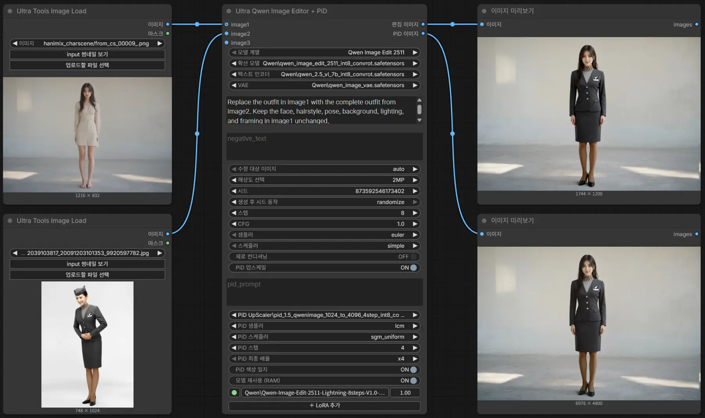

# Ultra Qwen Image Editor + PiD — v1.0.3

**Qwen 전용 ComfyUI 이미지 편집 커스텀 노드 / Native ComfyUI image-editing node for Qwen**

이미지를 입력하고 자연어로 편집합니다. **Qwen Image Edit 2511**과 **Qwen Image 2.1(Base/Turbo)**을 지원하며, 여러 장의 참조 이미지를 활용하고 수정할 이미지를 지정할 수 있습니다. LoRA를 적용할 수 있고, **PiD 업스케일은 Qwen 2511에 한해 선택적으로 제공**합니다.

**English overview:** Ultra Qwen Image Editor + PiD is a native ComfyUI custom node for reference-guided image editing with **Qwen Image Edit 2511** and **Qwen Image 2.1 (Base/Turbo)**. Connect one or more reference images, choose which input should be edited, then describe the changes in Korean or English. The node provides positive/negative prompts, aspect-aware resolution controls, editable sampling steps and CFG, a reorderable multi-LoRA stack, per-model settings recall, and optional asset reuse to reduce repeated loading.

It accepts up to **3 image inputs for Qwen 2511** or **10 for Qwen 2.1**, with dynamically added numbered sockets. English/Korean `imageN` references are remapped to match a changed edit target. For Qwen 2.1 Turbo, **8 steps use the built-in sigma schedule** while other step counts follow the selected KSampler scheduler. Optional **PiD x2/x4 upscaling and color matching are supported only for Qwen 2511**; Qwen 2.1 has no native PiD support in this node. Output images can be connected to ComfyUI's built-in `Save Image` node.


## 실제 편집 예시 / Image editing workflow



*정상 실행 예시: Qwen Image Edit 2511의 두 참조 이미지, 편집 결과, 선택적 PiD 업스케일 결과를 함께 보여줍니다. / A working Qwen Image Edit 2511 workflow showing two reference images, the edited output, and optional PiD upscaling. Widget labels automatically follow the ComfyUI Korean/English language setting.*

## 한글·영문 자동 전환 / Automatic Korean & English UI

**한국어:** ComfyUI의 언어 설정을 한국어 또는 영어로 변경하면, 노드의 **설정 이름·툴팁·LoRA 메뉴·안내 알림**이 자동으로 바뀝니다. 노드를 다시 설치하거나 언어팩을 수동으로 선택할 필요가 없습니다. 프롬프트는 한국어와 영어 모두 입력할 수 있습니다.

**English:** The node automatically follows ComfyUI's **Korean/English language setting**. Widget labels, contextual tooltips, LoRA controls, and user notifications switch to the selected language without a separate language pack or reinstall. Editing prompts may be written in either Korean or English. Technical identifiers such as model filenames, `imageN` sockets, sampler options, and stored workflow values intentionally remain unchanged to protect compatibility.

## Features / 주요 기능

| 기능 / Feature | 설명 / Description |
| --- | --- |
| 모델 / Models | Qwen Image Edit 2511; Qwen Image 2.1 Base/Turbo |
| 입력 이미지 / Inputs | 2511: 최대 3장 / up to 3; 2.1: 최대 10장 / up to 10 |
| 수정 대상 / Edit Target | `image1` 또는 연결된 다른 입력 선택 / select a connected image |
| 프롬프트 / Prompts | 노드 내부 긍정·부정 프롬프트 / built-in positive and negative prompts |
| 참조 번호 / References | 한·영 이미지 번호 자동 대응 / Korean & English numbered references |
| 해상도 / Resolution | 약 0.5·1·1.5·2MP, 원본, 사용자 지정 / MP presets, original, custom |
| 샘플링 / Sampling | Qwen 2.1 Turbo: 정확히 8스텝에서 내장 시그마, 그 외 KSampler |
| LoRA | 다중 LoRA·강도·순서·개별 ON/OFF / multiple LoRAs, strengths, ordering |
| PiD | Qwen 2511 전용 x2/x4 결과 및 선택적 색감 보정 |
| 언어 / Language | ComfyUI `Comfy.Locale` 기반 한글·영문 UI / KO-EN UI labels and tooltips |

## 설치 / Installation

**방법 1 — Git 설치 (권장) / Method 1 — Git clone (recommended)**

ComfyUI를 완전히 종료한 뒤, 터미널/PowerShell에서 `ComfyUI/custom_nodes` 폴더로 이동해 다음 명령을 실행합니다. / Close ComfyUI and open a terminal in the `ComfyUI/custom_nodes` directory:

```bash
git clone https://github.com/Yamoon-jjang/comfyui-Ultra-Qwen-Image-Editor.git
```

업데이트 / To update an existing Git installation:

```bash
cd comfyui-Ultra-Qwen-Image-Editor
git pull
```

**방법 2 — ZIP 설치 / Method 2 — ZIP download**

GitHub Releases의 ZIP을 다운로드해 압축을 풀고 `ComfyUI/custom_nodes/comfyui-Ultra-Qwen-Image-Editor/` 구조로 배치합니다. / Download the release ZIP and extract the included folder directly under `ComfyUI/custom_nodes/`.

**중복 설치 금지 / Avoid duplicate installations:** 예전 폴더 `comfyui-Ultra-Image-Editor` 또는 새 폴더의 다른 복사본이 있으면 ComfyUI를 종료한 상태에서 `custom_nodes` 밖으로 옮기세요. / Move any previous `comfyui-Ultra-Image-Editor` directory or duplicate copies out of `custom_nodes` before starting ComfyUI.

**최초 실행 / First run:** Install compatible Qwen diffusion model, text encoder, and VAE files in their regular ComfyUI model directories. Restart ComfyUI and search for `Ultra Qwen Image Editor + PiD`. Connect `image1` and send `Edited Image` to a `Save Image` node. No extra pip requirements are declared by this custom node.

최근 버전의 ComfyUI 코어와 호환 모델 파일이 필요합니다. 선택적 PiD에는 지원되는 QwenImage PiD 체크포인트와 Gemma 2 ELM 인코더가 별도로 필요합니다. / A recent ComfyUI build with the Qwen edit core nodes is required; optional PiD also needs its compatible checkpoint and Gemma 2 ELM encoder.

## 빠른 사용 / Quick start

1. `Model Family`에서 **Qwen Image Edit 2511** 또는 **Qwen Image 2.1**을 선택합니다.
2. 계열에 맞는 `Diffusion Model`, `Text Encoder`, `VAE`를 선택합니다.
3. `image1`에 편집할 이미지를 연결합니다. 이미지가 두 장 이상이면 `Edit Target`을 선택합니다.
4. 긍정 프롬프트에 편집 지시를 작성합니다. `image1`, `image2`, `이미지1`, `이미지2` 등 **입력 단자 번호**를 사용하세요.
5. `Steps`, `CFG`, `Sampler`, `Scheduler`, 해상도 및 선택적 LoRA를 설정합니다.
6. 이미지 출력을 `Save Image`에 연결하여 생성합니다.

*Example / 예시:* `이미지1의 옷을 유지하고 이미지2의 배경으로 변경해줘.` / `Keep the outfit from image1 and use the background from image2.`

**참고 / Note:** `이미지 1과 2` 또는 `image 1 and 2`처럼 번호를 묶어 쓰는 대신 **`이미지1과 이미지2` / `image1 and image2`**처럼 각각 명시하세요. / Name each reference explicitly to ensure correct renumbering.

## 모델별 기본 동작 / Sampling

| 계열 / Family | 일반적인 초기값 / Starting values | 샘플링 / Sampling |
| --- | --- | --- |
| Qwen Image Edit 2511 | 20 Steps, CFG 4 | KSampler |
| Qwen Image 2.1 Base | 25 Steps, CFG 1 | KSampler |
| Qwen Image 2.1 Turbo | 8 Steps, CFG 1 | **Steps=8:** built-in sigma schedule; **other steps:** KSampler |

Turbo의 8스텝 경로에서는 선택한 `Sampler`와 `CFG`가 반영되지만 `Scheduler` 값은 사용되지 않습니다. Turbo에서도 Steps와 CFG를 자유롭게 변경할 수 있습니다. / In Turbo's 8-step mode, CFG and Sampler are active but Scheduler is ignored; other step counts use the chosen KSampler scheduler.

## 설정 저장 / Profile persistence

모델별 Steps·CFG·샘플러·TE·VAE·LoRA·PiD 등은 **생성 요청이 큐에 성공적으로 등록된 뒤** 확정 프로필로 저장됩니다. 이미지가 최종 생성된 시점과는 다릅니다. 생성 전에 편집한 값은 모델 전환 중 **현재 화면 세션에서만** 임시 보관합니다. 긍정·부정 프롬프트, PiD 장면 프롬프트, 수정 대상, 해상도와 시드는 모델 전환 시 현재 값을 유지합니다. 워크플로를 보존하려면 ComfyUI에서 별도 저장하세요.

Per-model sampling, asset and LoRA settings are committed after **successful queue submission**, not after GPU completion. Unsaved drafts survive model switches only in the current editor session. Prompt texts, edit target, resolution and seed stay with the active task. Save the ComfyUI workflow separately for persistence.

## 언어 / Language

ComfyUI의 언어 설정(`Comfy.Locale`)을 한글 또는 영어로 변경하면 위젯 **표시 이름, 안내 툴팁, LoRA 메뉴와 노드 알림**이 전환됩니다. 모델 파일 이름, `imageN` 단자, 샘플러·스케줄러 및 시드의 내부 옵션 값 등 **워크플로 호환성에 필요한 식별자는 번역하지 않습니다.** Python 서버 오류 메시지는 ComfyUI 언어와 독립적으로 한국어로 나타날 수 있습니다.

Widget labels, tooltips, LoRA menus and in-node notifications follow the ComfyUI locale. Canonical workflow IDs, model filenames, sampler names and option tokens are intentionally unchanged. Some backend error messages are in Korean.

## 주의 / Notes

- `image1`부터 **중간 번호 없이** 연결해야 합니다. 모델 계열 변경 시 기존의 초과 이미지 연결은 먼저 해제하세요.
- 연결하지 않은 `imageN`을 문장에 작성해도 실행을 막지 않지만 해당 이미지의 **시각 정보는 제공되지 않습니다**.
- PiD는 Qwen Image Edit 2511 전용입니다. PiD의 내부 x4 연산이 8192px 제한을 넘으면 처리하지 않습니다.
- PiD OFF일 때 두 IMAGE 출력에는 동일한 편집 결과가 나옵니다.
- 본 노드는 이미지를 자동 저장하지 않습니다. ComfyUI의 `Save Image` 노드를 연결하세요.
- 실행 속도, VRAM 요구량과 이미지 품질은 설치한 모델 파일 및 시스템 환경에 따라 다릅니다.
- 이미지·워크플로 PNG에는 현재 프롬프트 등의 메타데이터가 포함될 수 있으므로 공유 전에 확인하세요.

## 자세한 설명 / Detailed manuals

- [한글 사용 설명서](메뉴얼.txt)
- [English manual](MANUAL_EN.md)

License: **GPL-3.0-or-later** — see `LICENSE`.
